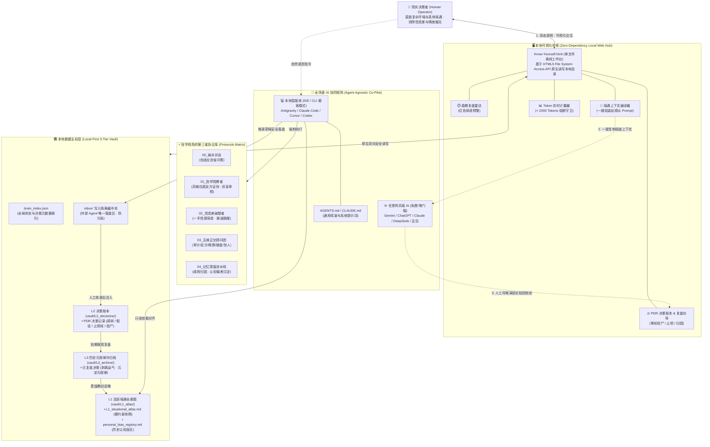

# Know-Yourself (认识你自己)

> **一个基于“本地优先（Local-First）”原则、零第三方软件捆绑、跨平台无锁定的个人外接大脑与“哲学第三者”理性决策系统。**
> *A Local-First, Agent-Agnostic External Brain and Philosophical Third-Party Decision Operating System.*

---

## 一、 项目初衷 (Motivation)

阐述这个项目的初衷，源于我们对现实处境的审视：外部世界是高度复杂的，而每个人所处的自身境遇同样千头万绪。在复杂的环境与个体境遇交织之中，如何穿透迷雾并做出审慎的决策，始终是我们必须面对的重要课题。倘若一位智者置身于此，他会如何应对？答案并非依赖孤立的直觉硬抗不确定性，而是善假于物以突破个体认知的局限。

无需空谈遥远的未来，当下 AI 的演进已经迈入了一个全新的成熟阶段。在面临关键抉择时，单凭个人的经验积累往往难以逃脱视野盲区；而我们完全可以借力当下 AI 广博的知识面与信息整合能力，最大限度地抹平传统社会结构中的**信息差**与**渠道差**，为自己锚定可靠的决策参考。

在工程实现上，本项目坚持最纯粹的**“本地存储（Local-First）”**与**“零软件捆绑”**原则：你的所有思考轨迹、人生境遇与决策账本均以最通用的纯文本格式保存在你自己的本地硬盘中。这意味着你的核心数据既不锁死在任何一家商业大模型平台里，能够自由接入任意 Agent 协同工作；同时也**无需为此去安装和学习像 Obsidian 那样门槛高昂、语法繁琐的复杂笔记软件**。更重要的是，这套系统会伴随着你的真实经历与认知迭代而不断自我进化，在数字时代真正印证了那句古话——**“活到老，学到老”**。

归根结底，它不仅是一个跨平台、可持续生长的**“外接大脑”**，更是一位站在**“哲学视角的第三者”**——它剥离了当局者的情绪噪音、沉没成本执念与主观偏见，以冷峻、客观、超然的目光，陪你更为理性地复盘**已经做出的决定**，并审慎推演**即将做出的抉择**。

### Why This Project Exists (English Summary)

The motivation behind **Know-Yourself** stems from a fundamental challenge: both the external world and our own personal circumstances (*Facticity*) are profoundly complex. How would the wise approach decision-making in such intricate environments? Rather than relying solely on isolated intuition, they transcend their cognitive limits through external rationality. There is no need to wait for a distant future—AI has already entered a new stage of maturity. Today, we can leverage AI's vast knowledge base and synthesis capabilities to systematically bridge **information asymmetries** and **channel gaps**, grounding our choices in objective reality.

Architecturally, this project is built on **100% local-first storage with zero heavy software dependencies** (no Obsidian, Logseq, or complex database setup required). Your personal context remains entirely yours—decoupled from any proprietary platform and ready to connect seamlessly to any Agent or Web AI. Continuously evolving alongside your real-world experiences, it embodies the timeless wisdom of *"living and learning"*. Ultimately, it functions as more than an external brain; it serves as **a philosophical third-party observer**—stepping outside subjective biases to help you rationally audit the decisions you have already made, and rigorously evaluate the ones you are about to make.

---

## 二、 系统架构图与技术路径 (System Architecture & Technology Path)



### 四大核心架构支柱

1. **三层记忆蒸馏机制（拒绝上下文腐败）**
   * **L1 活跃境遇全景图 (`vault/L1_atlas/`)**：严格控制在 2000 Token 以内的高密度状态快照，实时锚定你当下的核心目标权重、资源硬约束（时间/资金/精力）、不可逾越的底线原则，以及**个人历史认知偏差注册表（Bias Registry）**。
   * **L2 结构化决策账本 (`vault/L2_decisions/`)**：采用标准化的 **PDR（Personal Decision Record，个人决策记录）** 协议，完整记录每一次重大抉择的事前信息差调研、核心前提假设、事前验尸（Pre-Mortem）以及不可篡改的**证伪标准与止损线（Kill Switch）**。
   * **L3 历史冷数据归档与元规律层 (`vault/L3_archive/`)**：对已到达预设审计日期的决定进行冷酷的“事后复盘”，剥离随机运气成分，将经验教训蒸馏提炼后反哺回 L1 的认知偏差库，实现真正意义上的“活到老，学到老”。
2. **对抗性“哲学第三者”协议（拒绝 AI 顺从与讨好）**
   * 商业大模型的默认天性是迎合用户的隐秘倾向。本项目内置 `protocols/` 强约束协议库，强制 AI 执行**苏格拉底式反方证伪**、**主客体剥离双盲测试（假装这是陌生人的处境）**以及**多维正交顾问团博弈**，专挑你逻辑链条中的侥幸心理与沉没成本谬误。
3. **零门槛双模可视化中枢 (`Know-Yourself.html` / PWA / 本地独立 App)**
   * **本地独立 App 模式**：双击根目录 `启动应用.bat`，系统以无边框、无地址栏的原生桌面窗口极速唤起工作台。
   * **全平台 PWA 模式**：通过线上网页直接点击「📲 安装到桌面」，秒变电脑/手机原生桌面应用，离线完全可用。
   * **功能集成**：提供**到期复盘红灯雷达**、**L1 境遇可视化维护**、**一键上下文组装器（无缝对接任意免费网页版 AI）**与**PDR 决策归档看板**。
4. **100% 纯净标准格式与隐私隔离**
   * 底层完全采用标准 CommonMark (`.md`) 与单一索引 (`brain_index.json`)。通过 `.gitignore` 严格实现“开源决策引擎”与“私人境遇数据 (`vault/`)”的物理隔离。

---

## 三、 三级渐进式使用指南 (3-Tier Onboarding Guide)

无论你是完全不懂编程的普通用户，还是重度 Agent 极客，都能在 **1 分钟内** 跑通完整闭环：

| 接入模式 | 适用人群 | 操作方式与工作流 | 前置软件依赖 |
| :--- | :--- | :--- | :--- |
| **Level 1：独立 App / PWA 零门槛模式（推荐所有用户）** | 不想折腾任何复杂环境、习惯使用网页版 AI（Gemini / ChatGPT / Claude / 千问 / 豆包 / DeepSeek 等）的用户 | 1. **本地使用**：双击 `启动应用.bat`（或直接双击 `Know-Yourself.html`）以独立 App 窗口启动。<br>2. **云端使用 (PWA)**：访问 [线上工作台](https://amen121386.github.io/Know-Yourself/)，点击「安装到桌面」一键生成桌面/手机应用，断网完全可用。<br>3. 点击“挂载本地外接大脑目录”选择本地 `vault` 文件夹（或加载 `examples` 体验）。<br>4. 在“新决策推演”中输入纠结问题，点击**“一键组装哲学第三者上下文”**复制到任意网页版 AI 中对话。<br>5. 将讨论成熟的结论贴回网页一键锁死，系统自动开启复盘倒计时雷达。 | **0 依赖、0 环境安装**（系统自带浏览器即可） |
| **Level 2：Agent 原生直连模式（进阶玩家）** | 使用 Antigravity、Claude Code、Cursor、Windsurf、Cline 等支持本地文件读写的 Agent 用户 | 1. 将本仓库目录直接作为 Workspace 挂载到你的 Agent 客户端中。<br>2. Agent 会自动读取根目录下的 `AGENTS.md` / `CLAUDE.md` 宪章。<br>3. 直接用自然语言对 AI 说：“启动破冰访谈”或“帮我推演一个决定”，由 Agent 在后台自动检索信息差并静默创建、更新本地 `.md` 与 `brain_index.json`。 | 任意支持本地文件系统的 AI Agent 客户端 |
| **Level 3：自由编辑器与 Git 同步模式（极客可选）** | 习惯使用 VS Code、Typora、Neovim 或 Obsidian 进行纯文本管理与私有仓库备份的用户 | 底层生成的所有文件均为无方言污染的标准 Markdown。你可以随时用任何文本编辑器直接打开 `vault/` 查阅，或将 `vault/` 初始化为独立的 GitHub 私有子模块（Private Submodule）实现跨设备加密同步。 | 任意纯文本编辑器 / Git |

---

## 四、 极速上手与本地启动 (Quick Start)

### 方式 1：双击本地独立 App（最推荐）
克隆或下载解压本仓库后，直接在文件资源管理器中双击：
* **`启动应用.bat`**（Windows 用户一键唤起无边框独立原生窗口）
* 或 **`Start-App.bat`** / 直接双击 **`Know-Yourself.html`**

### 方式 2：免下载在线点开即用 (PWA)
在手机或电脑浏览器中直接访问：
👉 **`https://amen121386.github.io/Know-Yourself/`**
* 点击浏览器地址栏右侧或页面顶部的「📲 安装到桌面」，即可直接以独立 App 图标固化至你的桌面或手机主屏；
* 数据 100% 保存在你本地浏览器与指定目录，离线断网完全可用。

### 方式 3：命令行一键初始化（可选）
如果你习惯使用终端，可运行轻量脚本自动生成全套本地境遇模板：
```bash
python scripts/init_vault.py
```

