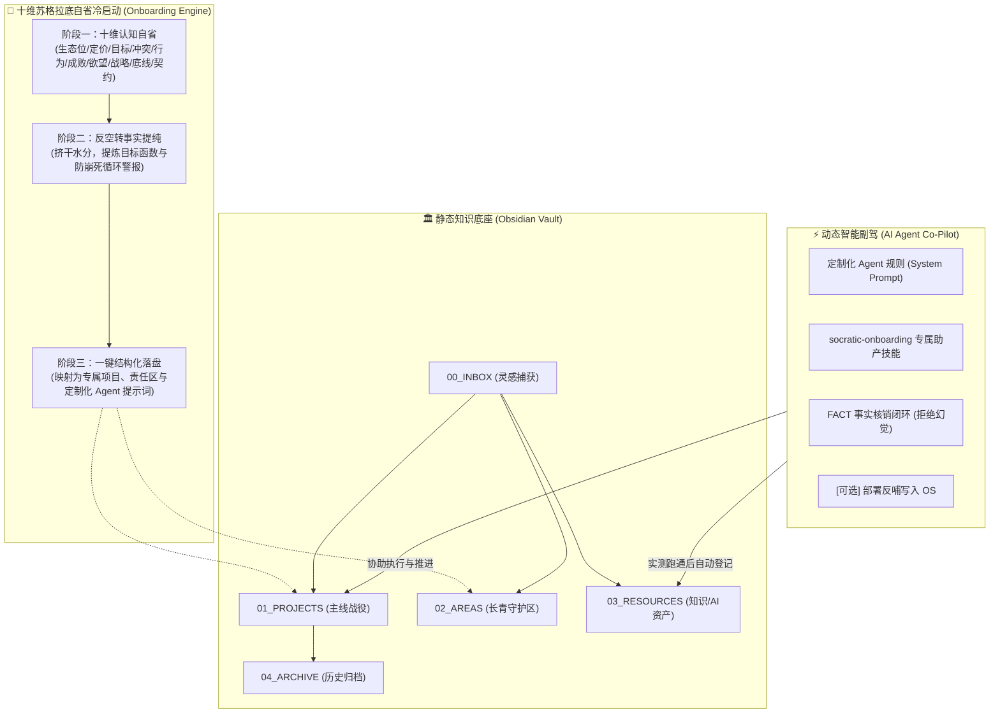

# Know Yourself (认识你自己) 🦉
### AI 原生驱动的双核个人操作系统 (Dual-Core Life OS & Socratic AI Workflow)

<p align="center">
  
  
  
  
</p>

> “认识你自己 (Nosce te ipsum)。” —— 德尔斐神谕刻辞 / 苏格拉底  
> “未经审视的人生是不值得过的。”

**Know Yourself** 是一套融合了**苏格拉底认知自省哲学（精神助产术）**、**现代 PARA 知识流**与**自主 AI Agent 事实闭环**的开源个人系统。它不仅提供一套纯粹的本地优先笔记底座，更独创了**一套通过十维认知递进访谈帮你击碎幻想、提炼真实自我的“冷启动生成协议”**。

---

## ⚡ 核心亮点：为什么它不是又一个平庸的空模版？

大部分个人知识库在下载后 3 天就被废弃，是因为“死板的空文件夹无法表达鲜活的个人”。**Know Yourself 独创了三大核心引擎**：

| 引擎模块 | 说明 | 解决的痛点 |
| :--- | :--- | :--- |
| **1. 十维苏格拉底自省助产** | 内置 [十维认知架构访谈协议](01_AI_Agent_Rules/onboarding/01_Socratic_Interview.md) 与原生 Skill，从**生态位、能力定价、终极目标、价值排序、行为基线、成败循环、欲望罗盘、战略分层、不可触碰红线、协同契约**深入剖析 | 摆脱“面对空文件夹不知道该写啥”的困境，挤干愿望水分，量身定做专属外脑 |
| **2. 双核流动知识底座** | 纯本地 Markdown（Obsidian 开箱即用），严格划分为 INBOX、PROJECTS、AREAS、RESOURCES、ARCHIVE | 终结碎片信息满天飞，降低认知内耗 |
| **3. FACT 事实核销契约** | 严谨务实的 AI 行为准则，任务绝不虚假承诺，必须经终端实测验证方可打勾 `[FACT]` | 向大模型胡说八道和幻觉宣战，打造确定性知识闭环 |

---

## 🏛️ 系统双核架构图



---

## 🚀 极速开箱使用（文科生与非技术用户）

👉 **直接阅读：[小白 3 步开箱即用指南](docs/QUICK_START.md)**

1. **第一步（对话）**：把 [01_Socratic_Interview.md](01_AI_Agent_Rules/onboarding/01_Socratic_Interview.md) 复制发给任意 AI（ChatGPT / Claude / Kimi / 豆包），如实回答问题；
2. **第二步（提纯）**：把 [02_Fact_Extraction.md](01_AI_Agent_Rules/onboarding/02_Fact_Extraction.md) 发给它，一键挤干水分并生成属于你的主线卡与长青守护区；
3. **第三步（开启）**：下载免费的 [Obsidian](https://obsidian.md/) 打开 `00_Life_OS_Template` 文件夹，把内容粘贴进去，系统瞬间活起来！

*(专业开发者亦可在 [QUICK_START.md](docs/QUICK_START.md) 中查阅 `socratic-onboarding` 技能与本地 Agent 全自动落盘指南)*

---

## 📂 仓库结构

```text
Know Yourself/
├── .gitignore                   # 安全防火墙：严防私密配置、Token、API Key 泄露
├── LICENSE                      # 知识共享署名-非商业性使用-相同方式共享 (CC BY-NC-SA 4.0)
├── README.md                    # 本文件
├── 00_Life_OS_Template/         # 【开箱即用】纯净 Obsidian 知识库模板
│   ├── 00_INBOX/                # 灵感收纳规范
│   ├── 01_PROJECTS/             # 活跃战役（附哲学读书会真实样例）
│   ├── 02_AREAS/                # 长期领域（身心、哲学、财务、人际底线）
│   ├── 03_RESOURCES/AI/         # AI 工具与技能登记资产表
│   ├── 04_ARCHIVE/              # 归档说明
│   └── 99_TEMPLATES/            # 项目卡、日审（日省录）、周复盘标准模板
├── 01_AI_Agent_Rules/           # 【核心灵魂】AI Agent 协同规则与系统提示词
│   ├── SYSTEM_PROMPT.md         # 通用提示词模板（称谓可自定义）
│   ├── onboarding/              # 🌟 苏格拉底精神助产冷启动生成器
│   │   ├── 01_Socratic_Interview.md # 十维认知深度自省访谈指令
│   │   ├── 02_Fact_Extraction.md    # 事实提纯、反空转建模指令
│   │   └── 03_Vault_Auto_Ingestion.md
│   ├── skills/                  # 挂载技能库
│   │   └── socratic-onboarding/ # 交互式助产冷启动 Agent 技能
│   └── rules/
│       ├── fact_verification.md # FACT 事实核销契约
│       └── auto_sync_os.md      # [可选插件] 部署反哺自动同步规则
└── docs/                        # 详细指引
    ├── QUICK_START.md           # 简洁明了的快速上手教程（含小白版与极客版）
    └── SAFE_PRACTICE.md         # 隐私与数据安全防泄漏指引
```

---

## 🔒 隐私与安全承诺

本项目为**100% 纯净骨架与方法论**：
- 不含任何原作者的个人隐私数据、真实资产日记或敏感网络拓扑；
- 预置严格的 `.gitignore`，防止任何 API Key 或 Obsidian 插件凭证泄露；
- 无论使用者基于本项目记录何种内容，全部数据 100% 存储在使用者本地电脑。

详见 [数据安全与防泄漏指南](docs/SAFE_PRACTICE.md)。

---

## 📜 许可证 (License)

本项目采用 **[Creative Commons Attribution-NonCommercial-ShareAlike 4.0 International (CC BY-NC-SA 4.0)](LICENSE)** 协议开源。

- **您可以自由分享与改编**（需保留原作者署名）；
- **仅供个人学习与非商业用途**；
- **相同方式共享**：任何二次改编版本必须以相同许可协议释出。
