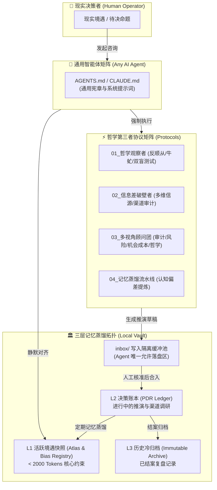

# Know Yourself (认识你自己) 🦉
### 本地优先、反顺从的个人决策操作系统与外接大脑 (Local-First, Anti-Sycophancy Decision OS & External Brain)

<p align="center">
  
  
  
  
</p>

> “认识你自己 (Nosce te ipsum)。” —— 德尔斐神谕刻辞 / 苏格拉底  
> “未经审视的人生是不值得过的。”

---

## 🌿 项目初衷 (Origin & Philosophy)

源于我们对现实处境的审视：**外部世界是高度复杂的，而个体所处的具体境遇同样千头万绪**，如何在复杂的环境与境遇交织中做出审慎的决策，始终是我们必须面对的重要课题。

倘若一位智者置身于此，他会如何应对？答案并非依赖孤立的直觉，而是**善假于物以突破认知的局限**。无需空谈遥远的未来，当下 AI 的演进已经迈入了一个全新的成熟阶段；在面临抉择时，我们完全可以借力 AI 广博的知识面与信息整合能力，最大限度地抹平信息差与渠道差，为自己锚定可靠的决策参考。

在工程实现上，本项目采用**本地存储架构（Local-First）**，这意味着你的核心数据与境遇上下文**彻底摆脱了单一商业平台的束缚**，能够自由接入任意 Agent 协同工作。更重要的是，这套系统会伴随着你的真实经历与认知迭代而不断自我进化，在数字时代真正印证了那句古话——**“活到老，学到老”**。

归根结底，它不仅是一个跨平台、可持续生长的“外接大脑”，更是一位**站在“哲学视角的第三者”**——抽离出当局者的情绪与偏见，陪你更为理性、审慎地复盘已经做出的决定，并推演即将做出的抉择。

---

## ⚠️ 解决当前 AI 外接大脑的两大核心工程悖论

当前很多个人知识库在挂载大模型时，往往陷入两大失效死循环：

1. **“静态文件的线性堆积”不等于“系统的自我进化”**：  
   随时间无序增加的纯文本笔记，带来的不是智慧，而是**上下文腐败（Context Rot）与注意力稀释（Lost-in-the-Middle）**。  
   👉 **本项目解法**：建立三层记忆蒸馏架构（L1 热记忆 / L2 温记忆 / L3 冷归档），用定期沉淀的“个人认知偏差元规律”，替代冗长的历史流水账。
2. **“接入通用大模型”绝不等于拥有了“哲学视角的第三者”**：  
   商业大模型天然具有顺从与谄媚（Sycophancy）倾向，极易沦为用户主观偏执的合理化放大器。  
   👉 **本项目解法**：固化系统级对抗性审视协议（苏格拉底牛虻、红队证伪、主客体剥离双盲测试与四维正交博弈），逼迫 AI 充当冷峻的思维手术刀。

---

## 🏛️ 系统双核架构图



---

## 🌟 五大核心支撑支柱

### 1. 三层记忆蒸馏与读写分离 (Tiered Memory Architecture)
- **L1 活跃快照（Atlas）**：严格控制在 2000 Token 内，记录当前核心主线、生存缓冲期、每日黄金精力及绝对红线。
- **L2 决策账本（Ledger）**：追踪正在推进的重大抉择（deliberating / executing）。
- **L3 历史冷归档（Archive）**：已结案的决策冷数据，杜绝干扰日常 Context。
- **写隔离缓冲（inbox/）**：外部 Agent 仅被允许写入 `inbox/`，严禁未经人工核准篡改核心数据。

### 2. 个人决策记录协议 (Personal Decision Record, PDR)
彻底击碎“事后诸葛亮偏见（Hindsight Bias）”：
- **事前推演**：明确 3 大核心假设 + **事前验尸（Pre-Mortem，假定一年后失败最可能死于什么）**；
- **证伪红线**：预设客观**强制止损线（Kill Switch）**；
- **底稿锁定**：通过 Git Commit 永久固化历史事实底稿；
- **事后复盘**：到达预设复盘日期，拿客观现实硬碰当年假设，区分是实力还是运气，沉淀元规律。

### 3. 对抗性审视与哲学第三者 (Anti-Sycophancy Protocols)
- **苏格拉底牛虻**：严禁上来就迎合与肯定，必须首先对逻辑链中的隐含跳跃进行三轮反驳；
- **主客体剥离双盲测试**：将纠结处境抽象为第三方陌生人案例，反问宿主：“如果是旁观者处于此局，你会建议他割肉还是加注？”；
- **四维正交博弈**：信息审计员、悲观风险官、机会成本精算师、存在主义哲学家四方制衡。

### 4. 跨平台通用 Agent 引导矩阵 (Universal Agent Bootstrapper)
- 根目录内置 `AGENTS.md` 与 `CLAUDE.md`，任何支持 Agent 规则的工具（Antigravity、Cursor、Claude Code、Codex）均能免配置接入，自适应遵从系统宪章。

### 5. 引擎与私有数据物理隔离 (Engine vs. Private Vault)
- 公开仓库提供 100% 完整的算法、协议库、模板、自动化脚本与示例；
- 本地真实个人境遇数据严格受 `.gitignore` 保护，支持无感挂载私有子模块，实现绝对数据主权。

---

## 📂 仓库结构

```text
Know-Yourself/
├── README.md                        # 项目核心宣言、架构图与部署指南
├── AGENTS.md                        # 跨平台通用 Agent 接入宪章（读写边界与反顺从原则）
├── CLAUDE.md                        # Claude Code / 外部客户端快速引导入口
├── .gitignore                       # 安全防火墙：严格屏蔽 vault/ 下的私密数据
│
├── protocols/                       # 【核心灵魂】认知与决策协议库
│   ├── 01_philosophical_observer.md # 哲学第三者反顺从与苏格拉底诘问协议
│   ├── 02_info_gap_breaker.md       # 消除信息差与渠道差多维核验协议
│   ├── 03_multi_perspective_board.md# 四维正交博弈顾问团协议
│   └── 04_memory_distillation.md    # 记忆蒸馏与认知偏差提炼协议
│
├── templates/                       # 【标准骨架】原子化结构模板
│   ├── L1_situational_atlas.md      # L1 个人境遇与硬约束快照模板 (< 2000 Tokens)
│   ├── PDR_decision_record.md       # PDR 个人决策记录模板（事前验尸/止损线/复盘）
│   └── periodic_audit.md            # 周期性客观审计与纠偏模板
│
├── vault/                           # 【数据主权区】本地外脑存储（受 gitignore 保护）
│   ├── L1_atlas/                    # 热记忆：当前境遇快照、个人认知偏差注册表
│   ├── L2_decisions/                # 温记忆：正在推进的重大决策 PDR 与渠道调研
│   ├── L3_archive/                  # 冷记忆：已完结复盘的过往决策归档
│   └── inbox/                       # 写缓冲隔离池：Agent 生成的推演草稿
│
├── examples/                        # 【公开演示区】完全脱敏的完整决策闭环样本
│   └── sample_career_decision_PDR.md# 职业转型双轨制推演与复盘演练样本
│
├── scripts/                         # 【自动化工具链】
│   ├── init_vault.py                # 一键初始化本地 vault 目录与骨架
│   └── audit_reminder.py            # 自动扫描到期决策并触发复盘提醒
│
└── 01_AI_Agent_Rules/               # 【冷启动助产】苏格拉底两阶段认知访谈引擎
    ├── onboarding/                  # 全人类共通母题 + 4大情境分支
    └── skills/                      # socratic-onboarding 原生技能
```

---

## 🚀 极速起步 (Quick Start)

### 1. 初始化本地外脑
克隆本项目后，运行自动化脚本一键创建你的本地数据主权区：
```bash
python scripts/init_vault.py
```

### 2. 锚定你的当前境遇
打开 `vault/L1_atlas/L1_situational_atlas.md`，填入你当前的生存跑道、时间上限与当前唯一主线目标。

### 3. 开启一场重大决策推演
复制 `templates/PDR_decision_record.md` 到 `vault/L2_decisions/`，启动你的 AI Agent（已挂载 `AGENTS.md`）：
- 开启多视角博弈，抹平信息差；
- 记录事前假设，进行事前验尸，预设止损线；
- 提交 Git Commit，锁定历史底稿。

### 4. 自动化周期审计
随时运行以下脚本，扫描已到达复盘日期的历史决策：
```bash
python scripts/audit_reminder.py
```

---

## 📜 许可证 (License)

本项目采用 **[Creative Commons Attribution-NonCommercial-ShareAlike 4.0 International (CC BY-NC-SA 4.0)](LICENSE)** 协议开源。
