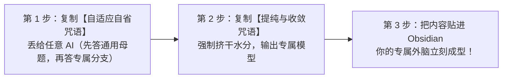

# Know Yourself OS - 开箱即用指南 (Quick Start Guide)

> “认识你自己，始于直面真实的自我。”  
> 本系统无需任何复杂的编程基础。无论你是文科生、职场人还是程序员，跟着这份指南，你都能在 10 分钟内拥有一套专属的个人外脑。

---

# 🚀 【小白极速版】3 步点石成金（非技术用户必看）

你不需要预先学很多复杂的笔记法则，只要会与 AI 对话，就能一键生成属于你自己的系统！

### 第一步：开启认知自省访谈（让 AI 问你）
1. 复制本项目中 [01_Socratic_Interview.md](../01_AI_Agent_Rules/onboarding/01_Socratic_Interview.md) 里的整段文字；
2. 打开你手机或电脑上的**任意 AI 软件**（ChatGPT、Claude、Kimi、豆包、微信 AI 均可），把文字发给它；
3. **两阶段自适应体验**：
   - **阶段一（人类相通母题）**：AI 会带你剖析时间有限性、安全与自由张力、多巴胺陷阱等 5 大全人类共通课题；
   - **阶段二（专属情境分支）**：根据你的特质，AI 会自动为你匹配【破局者（学生/青年）】、【跃迁者（职场/第二曲线）】、【创造者（学者/创作者）】或【重构者（危机防守）】专属追问。

### 第二步：挤干水分与反空转提纯（让 AI 建模）
1. 回答完毕后，在同一个对话窗口中，复制 [02_Fact_Extraction.md](../01_AI_Agent_Rules/onboarding/02_Fact_Extraction.md) 的文字发给它；
2. AI 会自动筛掉你的“自嗨与想当然”，强制收敛，提炼出你当前**唯一最重要的主线战役**、**长期守护的长青领域**、**防崩塌熔断机制**，以及**为你量身定制的专属 AI 系统提示词**。

### 第三步：装入 Obsidian 笔记本（开箱即用）
1. 电脑下载并安装 [Obsidian](https://obsidian.md/)（完全免费的本地笔记软件）；
2. 打开 Obsidian，点击「打开本地文件夹为库」，选择本项目里的 `00_Life_OS_Template`；
3. 把第二步 AI 生成的内容，直接复制到对应的文件夹里：
   - 核心主线战役 → 放在 `01_PROJECTS`
   - 长期责任区 → 放在 `02_AREAS`
   - 个性化 AI 提示词 → 更新至 `01_AI_Agent_Rules/SYSTEM_PROMPT.md`
4. **大功告成！** 你的外脑已经具备了鲜活的生命力。

---

# 💻 【专业极客版】AI Agent 自动化工作流 (Pro Developers)

如果你习惯使用支持文件读写与指令调用的智能体工具（如 **Antigravity**, **Cursor**, **Claude Code** 等），你可以享受全自动落盘体验：

### 1. 架构映射
- **底座 (Storage Layer)**：`00_Life_OS_Template` 遵循 PARA 本地优先哲学，无云端绑定，受严苛 `.gitignore` 保护。
- **副驾 (Agent Layer)**：`01_AI_Agent_Rules/` 承载 Agent 行为法则与技能包。
  - 核心外挂技能：`01_AI_Agent_Rules/skills/socratic-onboarding/`（支持 Agent 原生以两阶段状态机自适应引导用户交互并直接写盘）。

### 2. 自动化冷启动 (Automated Ingestion)
将 `01_AI_Agent_Rules/onboarding/03_Vault_Auto_Ingestion.md` 中的指令直接输入给你的本地 Agent：
- Agent 自动读取提纯上下文；
- 自动在 `01_PROJECTS/` 创建主线卡片 frontmatter 结构与待办；
- 自动写入 `02_AREAS/` 长青领域文档；
- 动态生成针对宿主真实决策习惯的专属 `SYSTEM_PROMPT.md`。

### 3. 运行期 FACT 核销机制
- 在 `01_AI_Agent_Rules/rules/fact_verification.md` 指引下，Agent 执行代码、部署环境或管理文件时，必须通过终端执行结果验证，方可在宿主的待办清单中标记 `[x] ... [FACT]`。
- 可选启用 `rules/auto_sync_os.md`，使 Agent 在部署新工具时自动反哺登记至 `03_RESOURCES/AI/AI_TOOLS.md`。
